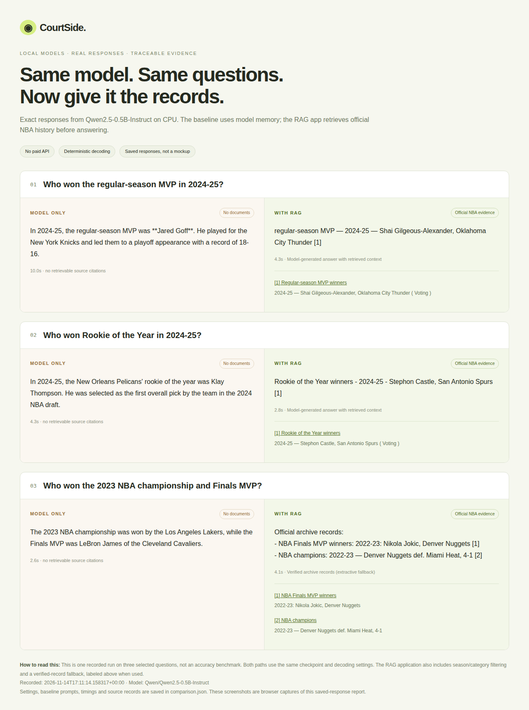

# CourtSide — local NBA RAG

A working application built from the notebooks' **load → split → embed → retrieve → generate** pipeline. Ask about NBA MVPs, Finals MVPs, champions, Defensive Player of the Year, and Rookie of the Year in a web chat. Answers include expandable retrieved passages and official source links.

**No OpenAI, paid inference, API keys, or cloud model calls.** Generation uses [Qwen2.5-0.5B-Instruct](https://huggingface.co/Qwen/Qwen2.5-0.5B-Instruct); embeddings use [all-MiniLM-L6-v2](https://huggingface.co/sentence-transformers/all-MiniLM-L6-v2). Both are Apache-2.0 models downloaded from Hugging Face and run in the Python process on CPU. The small default model fits modest hardware; factual accuracy still needs source checking.

## Why RAG matters — real local responses

The **same Qwen2.5-0.5B-Instruct checkpoint** answered the same three questions, once without documents and once through CourtSide. These are actual saved outputs, not illustrative answers. Both runs used CPU, greedy decoding, a 240-token output limit, and the same repetition penalty.



| Question | Model alone, in this run | CourtSide with official NBA records |
| --- | --- | --- |
| 2024–25 regular-season MVP | Jared Goff; invented NBA team details | Shai Gilgeous-Alexander, Oklahoma City Thunder, with source [1] |
| 2024–25 Rookie of the Year | Klay Thompson; invented draft details | Stephon Castle, San Antonio Spurs, with source [1] |
| 2023 champion and Finals MVP | Lakers; LeBron James with Cleveland | Denver Nuggets; Nikola Jokić, from matching official records |

Retrieval gives the model relevant facts instead of relying only on its training memory, and source links let the reader check the answer. For the first two examples, Qwen generated the cited RAG answers. For the third, the application’s coverage check used its **verified-record fallback**: those rows are extracted from the NBA documents rather than presented as model-written prose.

This is a three-example application demonstration, not a general accuracy benchmark or proof that retrieval alone fixes every mistake. The RAG path also uses a different prompt, season/category filtering, and the fallback described above. The screenshot is a browser capture of the [saved-response report](docs/comparison.html); exact responses, settings, timings, and source passages are in [comparison.json](docs/comparison.json). No responses were rewritten for the comparison.

To reproduce the run after setup:

```bash
HF_HUB_OFFLINE=1 uv run python -m scripts.compare
uv run --with playwright python -m playwright install chromium --only-shell
uv run --with playwright python -m scripts.render_comparison --capture
```

On Linux, if Chromium reports missing system libraries, use `uv run --with playwright python -m playwright install-deps chromium` (may require administrator access).

The questions are fixed in `scripts/compare.py`. The renderer reads the recorded JSON and captures the comparison page and each example as PNG files.

## Run

Install [uv](https://docs.astral.sh/uv/getting-started/installation/), then from this repository:

```bash
uv sync --python 3.12 --extra dev
uv run python -m nba_rag.setup
uv run uvicorn nba_rag.app:app --host 127.0.0.1 --port 8000
```

Open **http://localhost:8000**. The status line shows when models are ready. First setup downloads CPU PyTorch, about 1 GB of language model weights, the embedding model, and five official NBA pages. Allow several GB of disk space and roughly 4 GB available RAM. No GPU required; CPU answers may take tens of seconds. Python 3.12 is recommended; uv can provision it.

Downloads stay in `.cache/huggingface/`; source snapshots and the persistent vector index stay in `data/`. These generated directories are not included in the repository; this checkout keeps their exclusions in local Git metadata. After setup, inference is local. To ensure models load entirely offline:

```bash
HF_HUB_OFFLINE=1 uv run uvicorn nba_rag.app:app --host 127.0.0.1 --port 8000
```

The interface uses optional Google Fonts and falls back to system fonts offline. Links to NBA.com open external pages only when clicked.

## Questions to try

- Who won the regular-season MVP in 2023-24?
- Who won the 2023 NBA championship and Finals MVP?
- Which seasons did Michael Jordan win regular-season MVP?
- Who won Rookie of the Year in 2023-24?

Questions are independent: include names/seasons instead of using pronouns from an earlier message. This is a historical archive, not live scores or a prediction service. The UI displays snapshot download times; a fetch date does not guarantee that a source contains the latest season.

## Data and retrieval

The curated source URLs are in `nba_rag/config.py`. The ingester extracts NBA article bodies, preserves award rows, rejects missing/empty bodies, and keeps the previous corpus if any refresh fails. Pages are downloaded for personal research; ownership remains with the NBA. No fabricated seed dataset is substituted if a download fails.

Each NBA season row is indexed as an individual record with its award category and source URL. Other prose uses approximately 700-character chunks with one overlapping line. MiniLM mean-pools normalized embeddings; NumPy stores the vectors. Retrieval combines cosine similarity with keyword boosts, explicit season and award-category filters, and player names extracted from the archive. A bare year means the season ending that year: 2023 means 2022-23; use 2023-24 for an explicit season. A corpus hash invalidates stale cached vectors. Qwen sees up to six retrieved records and is instructed to cite only supplied evidence; an unrelated-query threshold abstains when evidence is weak. For precise season or player lookups, a coverage check verifies that the response includes every retrieved season, winner, and citation. If the small model omits any of these, the app shows the original matching NBA rows as a clearly labeled **Verified archive records** answer. General answers remain model-generated and can be wrong: inspect the evidence panel. Exhaustive career counts may require more records than the top six.

Refresh the data, then restart the server:

```bash
uv run python -m nba_rag.setup --refresh
```

Use a larger compatible local model when you have more RAM (additional download):

```bash
NBA_LLM=Qwen/Qwen2.5-1.5B-Instruct uv run python -m nba_rag.setup
NBA_LLM=Qwen/Qwen2.5-1.5B-Instruct uv run uvicorn nba_rag.app:app
```

## Development

```bash
uv run pytest -q
```

- `nba_rag/ingest.py`: official article download, extraction and chunking
- `nba_rag/engine.py`: local embeddings, persistent index, retrieval and generation
- `nba_rag/app.py`: FastAPI status and chat endpoints
- `nba_rag/static/`: responsive browser UI with source inspection
- `nba_local_rag.ipynb`: walkthrough using the same application code

Bind to loopback for personal use. This app has no authentication and is intended to run locally. Original lesson notebooks are preserved, including existing local edits; they still contain their original OpenAI examples.

The original [RAG From Scratch video playlist](https://youtube.com/playlist?list=PLfaIDFEXuae2LXbO1_PKyVJiQ23ZztA0x&feature=shared) explains the concepts behind the notebooks.
